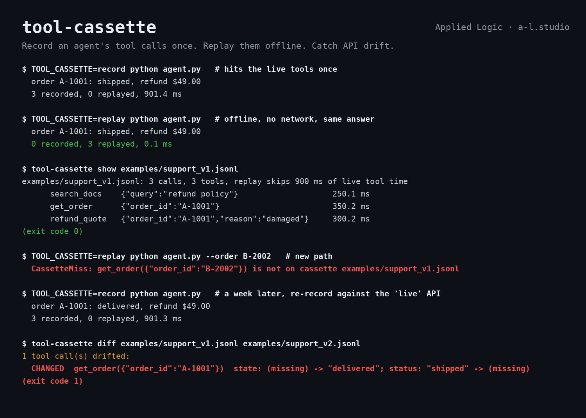

# tool-cassette

Record an agent's tool calls once. Replay them offline in tests. Catch it when the real API drifts.

Agent tests are slow, flaky, and cost money because every run hits live tools: search, databases, internal APIs. tool-cassette wraps your tool functions so the first run records each call and its result to a JSONL "cassette", and later runs replay from it with no network. When you re-record, `tool-cassette diff` tells you exactly which tool outputs changed underneath your agent.

Same idea as VCR or pytest-recording, but at the tool-call layer, where agents actually break.

Python 3.9+, stdlib only. No API keys, no network.



## Quickstart

```bash
git clone https://github.com/jakehb1/tool-cassette && cd tool-cassette && python3 demo.py
```

The demo runs a scripted mock support agent against three fake tools (plain Python functions that sleep to act like slow APIs). It records a cassette, replays it, hits a call that isn't on the cassette, then re-records against a "changed" API and diffs the two. The `$ ...` lines show the equivalent commands; everything runs inside `demo.py`.

## Demo output

```
$ TOOL_CASSETTE=record python agent.py   # hits the live tools once
  order A-1001: shipped, refund $49.00
  3 recorded, 0 replayed, 901.2 ms

$ TOOL_CASSETTE=replay python agent.py   # offline, no network, same answer
  order A-1001: shipped, refund $49.00
  0 recorded, 3 replayed, 0.1 ms

$ tool-cassette show examples/support_v1.jsonl
examples/support_v1.jsonl: 3 calls, 3 tools, replay skips 900 ms of live tool time
      search_docs    {"query":"refund policy"}                    250.1 ms
      get_order      {"order_id":"A-1001"}                        350.1 ms
      refund_quote   {"order_id":"A-1001","reason":"damaged"}     300.1 ms
(exit code 0)

$ TOOL_CASSETTE=replay python agent.py --order B-2002   # new path
  CassetteMiss: get_order({"order_id":"B-2002"}) is not on cassette examples/support_v1.jsonl

$ TOOL_CASSETTE=record python agent.py   # a week later, re-record against the 'live' API
  order A-1001: delivered, refund $49.00
  3 recorded, 0 replayed, 901.2 ms

$ tool-cassette diff examples/support_v1.jsonl examples/support_v2.jsonl
1 tool call(s) drifted:
  CHANGED  get_order({"order_id":"A-1001"})  state: (missing) -> "delivered"; status: "shipped" -> (missing)
(exit code 1)
```

Timings are from a real run on my machine and will differ on yours.

## Use it

```python
from toolcassette import Cassette

cassette = Cassette("tests/cassettes/refund_flow.jsonl")   # mode from TOOL_CASSETTE, default "auto"

@cassette.tool
def get_order(order_id):
    return orders_api.get(order_id)          # your real tool

# hand get_order to your agent as usual; call tools with keyword args
```

```bash
TOOL_CASSETTE=record pytest     # hit live tools, overwrite cassettes
TOOL_CASSETTE=replay pytest     # offline; any unrecorded call raises CassetteMiss (use this in CI)
pytest                          # auto: replay what's recorded, record what's new
```

Modes:

- **record**: call the real tool and write every call to the cassette (overwrites it).
- **replay**: never call the real tool. A call that isn't on the cassette raises `CassetteMiss`, so a prompt change that sends the agent down a new path fails loudly instead of quietly hitting production.
- **auto**: replay calls that are on the cassette, record the ones that aren't.

Details:

- Calls are matched on tool name + canonical JSON of the args (key order doesn't matter).
- If the agent makes the same call several times, replays come back in recorded order; extra calls get the last answer.
- Tool errors are recorded too, and replay raises `RuntimeError` with the same message, so error-handling paths are testable offline.
- Results must be JSON-serializable. Cassettes are plain JSONL, so they diff cleanly in code review. Don't record secrets or customer data into them.

## CLI

```bash
pip install .                       # or: python3 -m toolcassette ...
tool-cassette show cassette.jsonl   # list calls and how much live tool time a replay skips
tool-cassette diff old.jsonl new.jsonl          # exit 1 if any tool output drifted
tool-cassette diff old.jsonl new.jsonl --json   # machine-readable
```

`diff` reports **changed** (same call, different result, with field-level changes for dict results), **added** (new call), and **removed** (call no longer made). Exit codes: `0` no drift, `1` drift, `2` bad input.

## Tests

```bash
python3 -m unittest discover -s tests -v
```

## License

MIT

---

Built by Jakeh Bradley · Applied Logic (https://a-l.studio)
